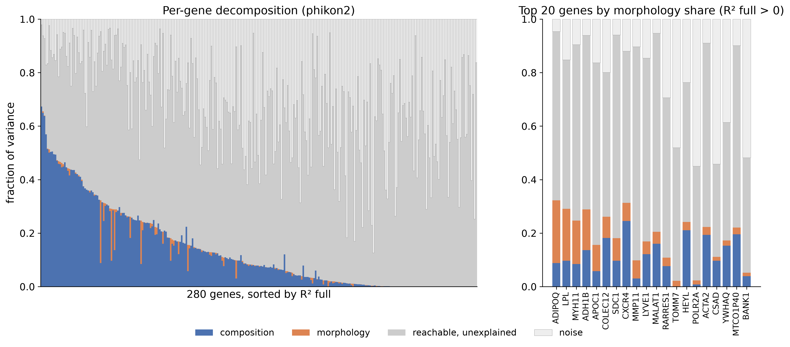
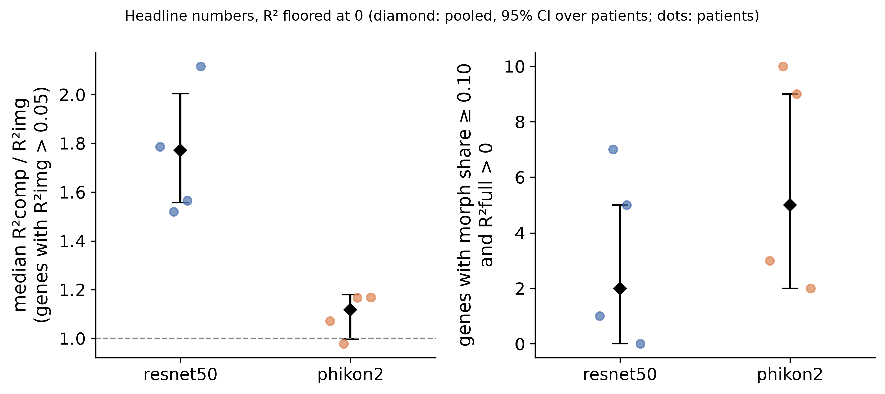
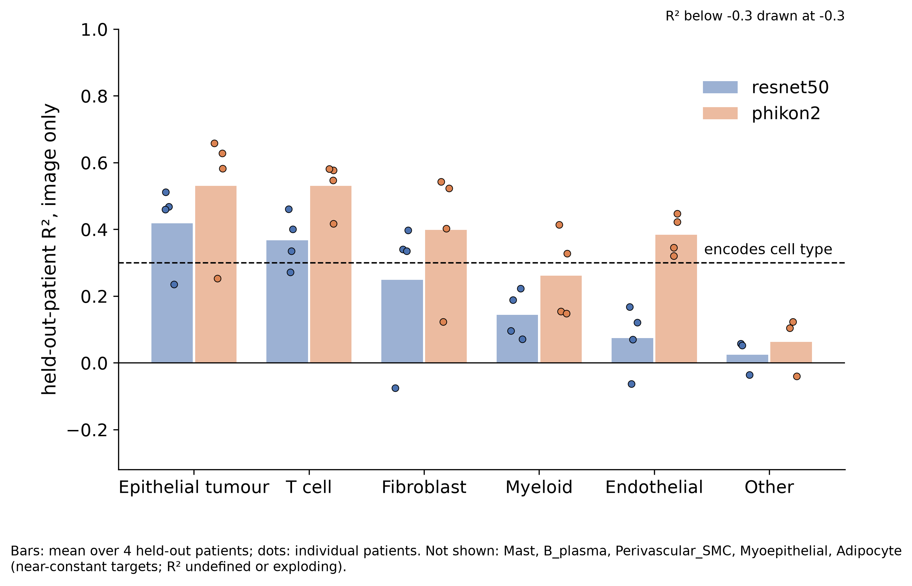
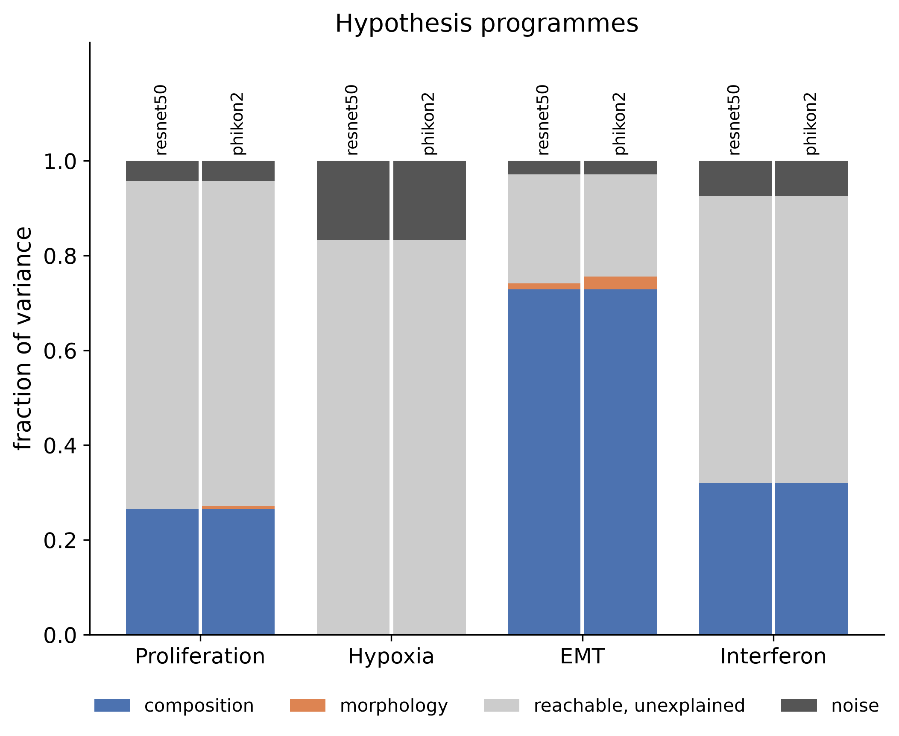

# Noise, composition or morphology? Decomposing H&E → gene-expression prediction

**Question.** When a model predicts gene expression from H&E images, how much of each gene's score comes from:
1. measurement noise,
2. cell-type composition,
3. genuine morphology signal?

We separate these per gene, each as a fraction of a per-gene noise ceiling.

**Why it matters.** H&E-to-expression models are scored by one accuracy number per gene ([He et al. 2020](https://doi.org/10.1038/s41551-020-0578-x); [Jaume et al. 2024](https://arxiv.org/abs/2406.16192)), and a benchmark of eleven methods found modest accuracy and no single best method ([Wang et al. 2025](https://doi.org/10.1038/s41467-025-56618-y)). H&E features are known to capture tumour composition ([Fu et al. 2020](https://doi.org/10.1038/s43018-020-0085-8)). We measure, per gene, how much of the accuracy is just composition.

**How.** Data thinning ([Neufeld et al. 2024](https://jmlr.org/papers/v25/23-0446.html)) splits one Xenium assay into independent parts for cell typing, a split-half noise ceiling ([Lage-Castellanos et al. 2019](https://doi.org/10.1371/journal.pcbi.1006397)) and the prediction target. Nested ridge models with leave-one-patient-out validation separate composition from image signal beyond composition.

## Documents
| | |
|---|---|
| **Report (PDF)** | [`reports/PROJECT_REPORT.pdf`](reports/PROJECT_REPORT.pdf), 8-page paper with figures and references |
| Report (Markdown) | [`reports/PROJECT_REPORT.md`](reports/PROJECT_REPORT.md), same text, readable on GitHub |
| LaTeX source | [`reports/latex/`](reports/latex/) (`main.tex`, `references.bib`) |
| Presentation | [`presentation/DH607_presentation_noise_composition_morphology.pdf`](presentation/DH607_presentation_noise_composition_morphology.pdf) |
| 📌 Results summary | [`reports/RESULTS_SUMMARY.md`](reports/RESULTS_SUMMARY.md), short poster version |

**Data.**
- [HEST-1k](https://github.com/mahmoodlab/HEST) v1.3.0 ([Hugging Face](https://huggingface.co/datasets/MahmoodLab/hest)), the 10x Genomics Xenium study *"Human Breast FFPE with Biomarkers & Housekeeping Genes Custom Panel"* ([10x datasets](https://www.10xgenomics.com/datasets)).
- 280-gene panel; 4 patients, one representative section each (TENX191, TENX195, TENX199, TENX202).
- 100 µm pseudo-spots, each with a 224 px H&E patch at 0.5 µm/px.

## Pipeline (`pipeline/`)
| Step | Script | What it does |
|---|---|---|
| 01 | `01_download_core.py` | Download HEST metadata, expression, patches and transcripts |
| 02 | `02_build_spots.py` | QC (qv ≥ 20), binomial thinning into A / B1 / B2, transcript → spot assignment, Leiden cell typing on A, composition per spot |
| 03 | `03_extract_features.py` | Image features: ResNet-50 (ImageNet) and Phikon-v2 |
| 04 | `04_decompose.py` | Noise ceiling (Spearman–Brown of B1 vs B2); ridge models for composition, image, and image-on-composition-residuals; leave-one-patient-out with inner alpha selection |
| 05 | `05_figures.py` | Main figures |
| 06 | `06_image_to_composition.py`, `06b_per_patient.py` | Robustness: image → cell types; per-patient consistency and bootstrap CIs |

Further robustness steps:
- `02b`/`04b`: joint cell typing with Harmony.
- `07`: robustness figures.
- `08`: shares with held-out R² floored at 0.

## How to run
```bash
export DH607_STORAGE=/path/to/storage          # data, features and results go under $DH607_STORAGE/dh607
pip install numpy pandas "scipy==1.13.1" "numba==0.61.2" scanpy==1.11.5 anndata leidenalg igraph \
            umap-learn harmonypy pyarrow h5py matplotlib torch torchvision transformers huggingface_hub
python pipeline/01_download_core.py
python pipeline/02_build_spots.py TENX191        # repeat for TENX195, TENX199, TENX202
python pipeline/03_extract_features.py TENX191 TENX195 TENX199 TENX202
python pipeline/04_decompose.py resnet50 --samples TENX191 TENX195 TENX199 TENX202   # and phikon2
python pipeline/05_figures.py
```
HEST is gated: accept its terms on Hugging Face and log in first.

## Key results ([full summary](reports/RESULTS_SUMMARY.md) · [project report](reports/PROJECT_REPORT.md))
- **Failure is not mostly noise.** The median noise ceiling is 0.707, and only 3 of 280 genes are noise-limited. Yet 226 (ResNet-50) and 181 (Phikon-v2) genes are not predicted across patients.
- **Apparent image success is mostly composition.** Median R²_comp / R²_img is 1.77 [95% CI 1.56–2.00] for ResNet-50 and 1.12 [1.00–1.18] for Phikon-v2. This holds in 4 of 4 held-out patients.
- **Morphology beyond composition is rare.** Only 2 and 5 genes pass, all adipose/lipid or smooth-muscle markers, and only MYH11 replicates in at least 3 of 4 patients. No programme (proliferation, EMT, interferon, hypoxia) shows morphology signal.
- **Phikon-v2 sees more composition, not more morphology.** H&E features encode the major cell types (epithelial and T-cell R² 0.42–0.53).

| | |
|---|---|
|  |  |
|  |  |

### Building the PDF
```bash
cd reports/latex && latexmk -pdf main.tex     # figures are read from ../../results/
```

## Limitations
- One study, one section per patient (n = 4), 280-gene panel.
- Imperfect cell-type labels make Δmorph an upper bound; joint typing did not fix this.
- Absolute image performance is below the random-split HEST-Benchmark, as expected under leave-one-patient-out.
- Binomial (Poisson) thinning, not negative-binomial.
- Gated foundation models (UNI2-h, Virchow2) were not tested.

## Authors
Bipra Bhanu Mohanty and Madhur Omprakash Likhmani. DH607 Computational Multi-omics, IIT Bombay; instructor Prof. Saket Choudhary.

## Citation
```bibtex
@misc{mohanty2026morphology,
  author = {Mohanty, Bipra Bhanu and Likhmani, Madhur Omprakash},
  title  = {What Does Tissue Morphology Encode? Separating Measurement Noise, Cell-Type Composition and Morphology in {H\&E}-to-Gene-Expression Prediction},
  year   = {2026},
  note   = {DH607 course project, IIT Bombay},
  url    = {https://github.com/biprabhanu/histology-transcriptomics-decomposition}
}
```

*`archive/phase1_baseline/` holds the earlier HEST-Bench baseline (Phase 1: ResNet-50 + ridge on HEST IDC).*
