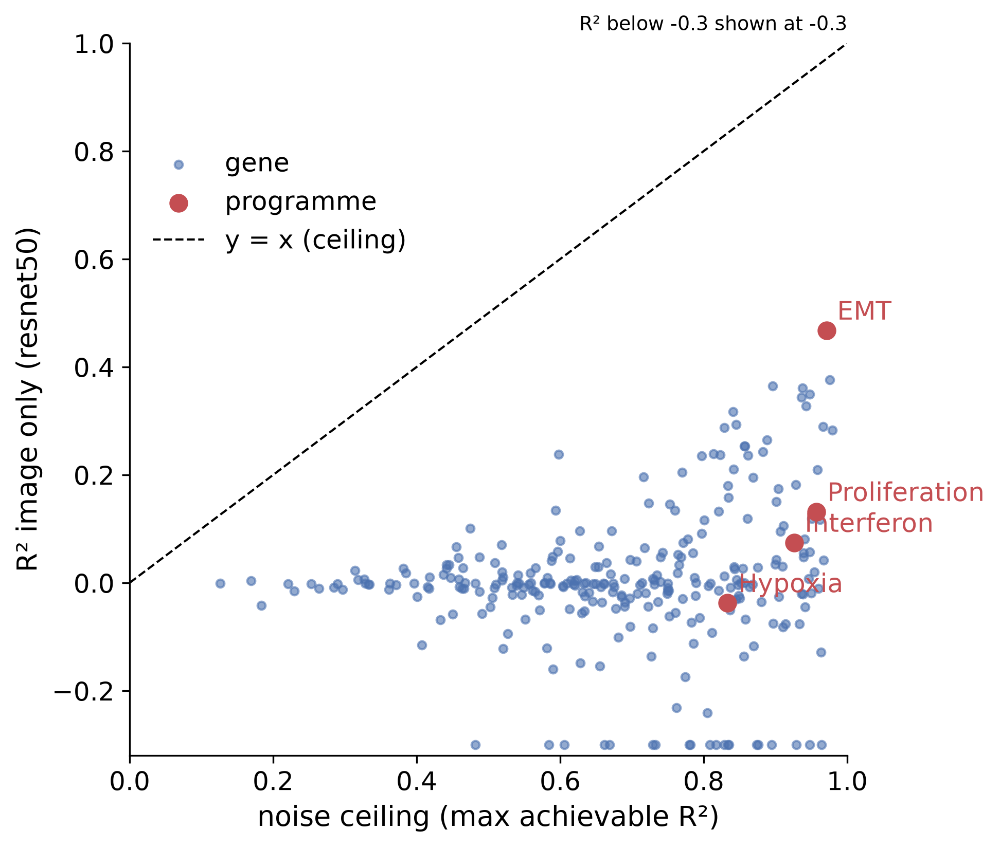
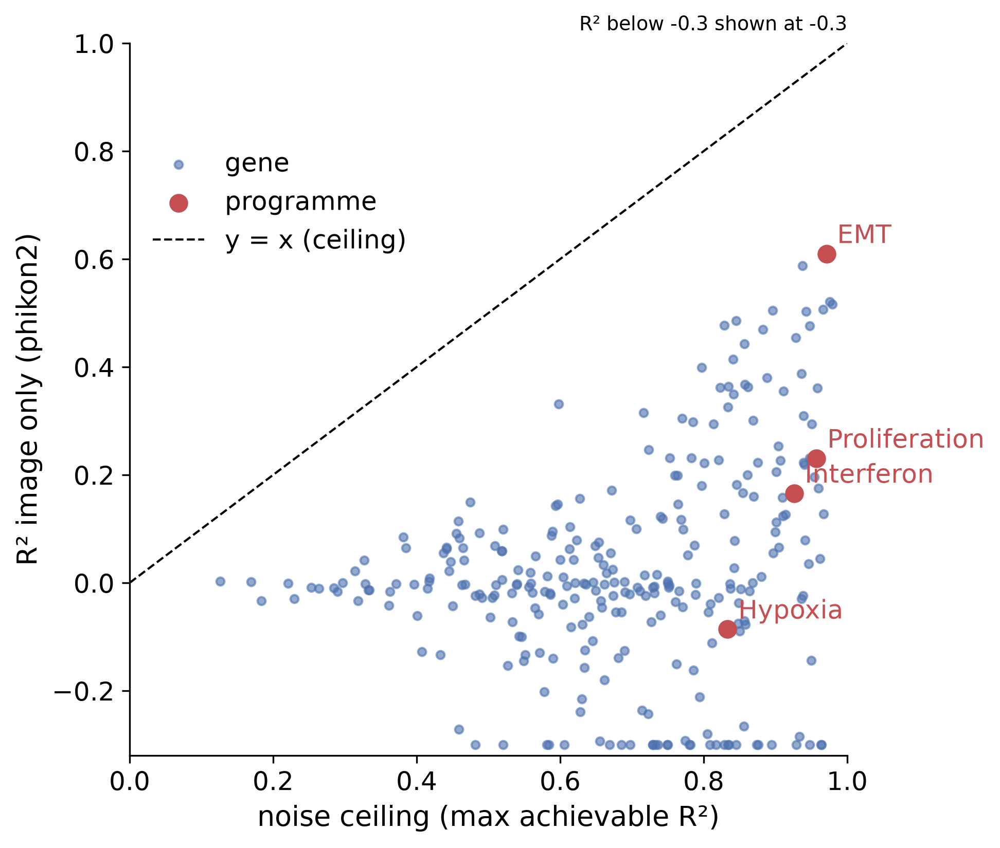
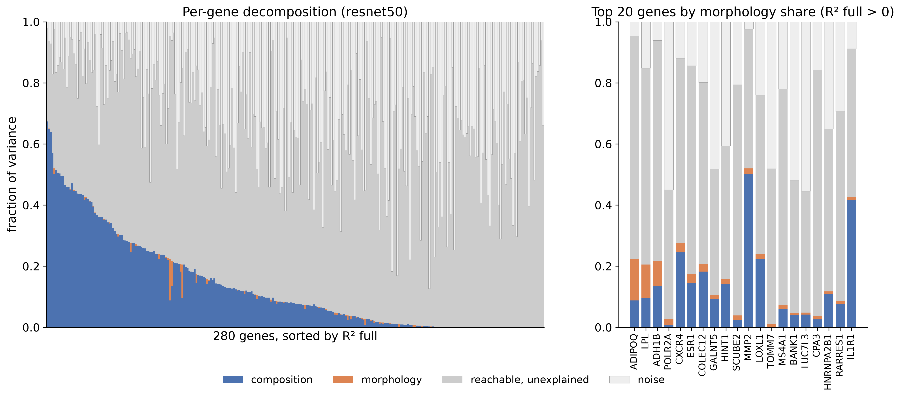
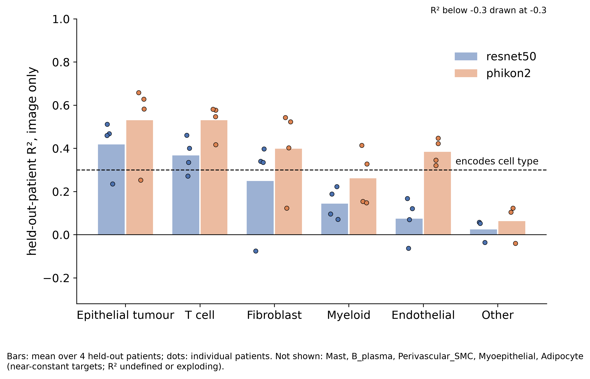
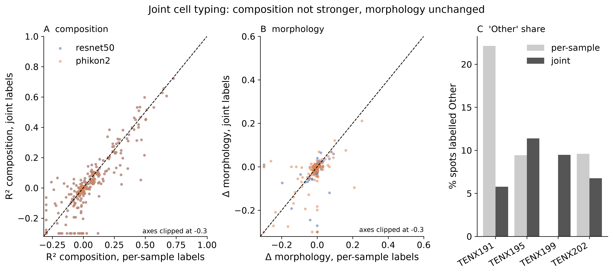

# What Does Tissue Morphology Encode? Separating Measurement Noise, Cell-Type Composition and Morphology in H&E-to-Gene-Expression Prediction

**Bipra Bhanu Mohanty, Madhur Omprakash Likhmani**
DH607 Computational Multi-omics, IIT Bombay. Instructor: Prof. Saket Choudhary. November 2026.

> 📄 [PDF version](PROJECT_REPORT.pdf) · 🧾 [LaTeX source](latex/) · 📊 [Slides](../presentation/)

## Abstract

Models that predict gene expression from H&E images are usually judged by one accuracy score per gene. That score mixes three things: measurement noise in the target, the cell-type composition of the tissue, and morphology beyond composition. We separate the three for every gene on a 10x Genomics Xenium breast cancer study from HEST-1k (280 genes, 4 patients, 100 µm spots). Binomial data thinning splits each spot’s transcripts into independent parts, so one assay gives (i) cell types, (ii) a noise ceiling and (iii) the prediction target. Ridge models on composition, on image features (ResNet-50, Phikon-v2), and on image features fitted to composition residuals are tested on held-out patients. Noise is not the bottleneck: the median ceiling is $0.707$ and only 3 of 280 genes are noise-limited, yet most genes are not predicted. Where the image succeeds, composition alone does as well or better (median $R^2_{\mathrm{comp}}/R^2_{\mathrm{img}}= 1.77$ for ResNet-50 and $1.12$ for Phikon-v2, in all 4 patients). Morphology signal beyond composition appears in only 2 and 5 genes, all adipose or smooth-muscle markers, and only *MYH11* replicates. No biological programme shows morphology signal. On this data, H&E-to-expression models mainly read out which cells are present.

### 🔑 Key findings at a glance

1.  **Failure is not noise.** 277 of 280 genes are measured reliably, but 226 (ResNet-50) and 181 (Phikon-v2) are not predicted in new patients.

2.  **Success is composition.** For genes the image predicts, cell-type fractions alone predict as well or better, in every patient and for both encoders.

3.  **The image sees cell types.** H&E features predict epithelial, T-cell, fibroblast and endothelial fractions in unseen patients.

4.  **Little morphology beyond composition.** 2–5 genes, all likely cell types we missed; only 1 replicates.

5.  **Programmes are composition.** Proliferation, EMT and interferon are explained by composition; hypoxia is not predicted.

## 1. Introduction and literature review

**Predicting expression from H&E.** Routine H&E slides exist for millions of patients, while spatial transcriptomics is expensive. Predicting expression from H&E would bring molecular read-outs to these archives. ST-Net was the first model to predict spatial gene expression from H&E patches, at 100 µm in breast cancer [1]. HEST-1k then paired over a thousand H&E images with spatial transcriptomics and benchmarked image encoders on this task; pathology foundation models scored higher than ImageNet features [2]. An independent benchmark of eleven methods found modest accuracy, limited generalisation to new datasets and no single best method [3].

**The gap.** All these studies report one correlation or $R^2$ per gene. This score cannot say *why* a gene is or is not predicted:

- a *low* score may mean the gene is too noisy for any model to predict;

- a *high* score may only mean the image recognises cell types, because many genes are cell-type markers and H&E features are known to capture tumour composition and immune infiltration [4].

Neither case shows that tissue morphology carries information about expression *beyond* which cells are present. If most accuracy is composition, a better encoder may simply be a better cell-type detector.

**Tools we borrow.** *Data thinning* splits a Poisson count into independent Poisson parts, giving synthetic replicates from a single measurement [5]. In neuroscience, models are judged against a *noise ceiling*, the best accuracy possible given the noise in repeated measurements [6]. We combine the two ideas.

**Novelty.** To our knowledge, this is the first per-gene decomposition of H&E-to-expression accuracy into noise, composition and morphology in which (a) composition is measured on data independent of the target and (b) every share is expressed relative to a noise ceiling from the same assay. Our contribution is an evaluation framework, not another predictor.

**Hypotheses.**

- **H1:** much apparent failure is measurement noise.

- **H2:** much apparent success is cell-type composition.

- **H3:** proliferation, hypoxia, EMT and interferon programmes are visible in morphology beyond composition.

## 2. Data

- **Source:** HEST-1k v1.3.0 [2], study *Human Breast FFPE with Biomarkers & Housekeeping Genes Custom Panel* (10x Genomics Xenium).

- **Panel:** 280 genes. Xenium records the position and quality of every transcript, which is what makes thinning and cell typing on the same tissue possible.

- **Patients:** 4, one section each (Table 1). One section per patient keeps leave-one-patient-out validation clean.

- **Spots:** 100 µm squares, each with a $224\times224$ px H&E patch at 0.5 µm/px. Spots with $<3$ cells or $<50$ counts were removed. All 280 genes were kept.

| Sample  | Patient | Spots (patch / kept) | Typed cells | “Other” (%) | In spots (%) |
|:--------|:--------|---------------------:|------------:|------------:|-------------:|
| TENX191 | P1      |          4949 / 4605 |      193448 |        22.1 |         99.8 |
| TENX195 | P2      |          6254 / 5971 |      319213 |         9.4 |         99.9 |
| TENX199 | P3      |          2259 / 2247 |      146234 |         0.0 |         99.5 |
| TENX202 | P4      |          4291 / 4253 |      197820 |         9.6 |         99.8 |

**Samples used.** “Other”: typed cells with no clear marker signature. “In spots”: share of quality-passing transcripts that fall inside a spot.

## 3. Methods

<figure id="fig:pipeline">

<figcaption><b>Figure 1.</b> <strong>Pipeline.</strong> One set of transcripts gives the composition, the noise ceiling and the target. Transcripts are split at random into A (50%), B1 (25%) and B2 (25%): A → cell types and composition; B1 vs. B2 → noise ceiling; <em>B</em> = <em>B</em>1 + <em>B</em>2 → target. Ridge models are trained on 3 patients and tested on the 4th.</figcaption>
</figure>

### 3.1 Binomial data thinning

Transcripts with quality $\mathrm{qv}\ge20$ on panel genes (control probes removed) were each assigned independently to A, B1 or B2: $$(A_{gs}, B1_{gs}, B2_{gs}) \mid X_{gs} \sim \mathrm{Multinomial}(X_{gs};\,0.5,\,0.25,\,0.25).$$ If $X_{gs}\sim\mathrm{Poisson}(\lambda_{gs})$, the three parts are *independent* Poisson variables with means $\lambda/2$, $\lambda/4$, $\lambda/4$ [5]. So cell types from A share the tissue’s biology with the target B but *not* its sampling noise. Without this, composition could “explain” the target simply by sharing its noise.

### 3.2 Cell typing and composition

Part-A counts were summed per cell (cells with $\ge10$ part-A transcripts). Per sample: normalise, log-transform, PCA (30 components), 15-nearest-neighbour graph, Leiden clustering (resolution 1.0) in Scanpy. Each cluster got the best of ten marker-defined types (epithelial/tumour, fibroblast, myeloid, endothelial, T cell, B/plasma, mast, adipocyte, myoepithelial, perivascular smooth muscle), or “Other” if its best score was $<0.3$. Composition per spot = 11 type fractions + log cell count (12 features).

### 3.3 Image encoders

- **ResNet-50** with ImageNet weights [7]: general-purpose, 2,048 features.

- **Phikon-v2** [8]: pathology foundation model (ViT-L, self-supervised on histology), 1,024 features.

Both were frozen; a linear read-out keeps the comparison about what the features contain.

### 3.4 Noise ceiling

For each gene, $y=\log(1+100\cdot C/\text{total counts})$ was computed for $C=B1$ and $B2$. With $r_g$ their correlation across spots, the Spearman–Brown formula gives the reliability of $B$: $$c_g = \frac{2r_g}{1+r_g}.$$ $c_g$ is the share of target variance that is not noise, so it is the highest held-out $R^2$ any model can reach [6]. Programme scores (proliferation 20 genes, EMT 15, hypoxia 8, interferon 4) are averages of within-sample z-scores and get their own ceilings.

### 3.5 Decomposition

Three ridge models predict $B$:

- **Composition model** (12 features) $\rightarrow R^2_{\mathrm{comp}}$;

- **Image model** (image features) $\rightarrow R^2_{\mathrm{img}}$;

- **Full model**: composition model + an image model fitted to the composition model’s residuals $\rightarrow R^2_{\mathrm{full}}$.

Because the image part only sees what composition leaves, $\Delta_{\mathrm{morph}}= R^2_{\mathrm{full}}- R^2_{\mathrm{comp}}$ is the image signal *beyond* composition. Shares of the ceiling: $\text{comp\_share}=R^2_{\mathrm{comp}}/c_g$, $\text{morph\_share}=\Delta_{\mathrm{morph}}/c_g$ (genes with $c_g\ge0.2$). Each gene’s variance therefore splits into four parts: composition, morphology, reachable but unexplained ($c_g-R^2_{\mathrm{full}}$), and noise ($1-c_g$).

**Gene categories:** *noise-limited* ($c_g<0.2$); else *morphology-visible* (morph_share $\ge0.10$); else *composition-explained* ($R^2_{\mathrm{img}}\ge0.1\,c_g$); else *not predicted*.

### 3.6 Validation and robustness

- **Leave-one-patient-out**, 4 folds. Ridge penalty chosen by an inner leave-one-patient-out over 21 values ($10^{-1}$–$10^{9}$). Features z-scored within sample.

- **Floored $R^2$:** for headline shares, each held-out $R^2$ was floored at 0, because a gene with near-zero variance in one patient can give extreme values (e.g. *NPY1R* $\Delta_{\mathrm{morph}}=2.24$ in P4). Gene categories use unfloored values.

- **Uncertainty:** 1,000 patient-level bootstrap resamples, 95% intervals.

- **Checks fixed before seeing results:** shuffled-image control; image $\rightarrow$ cell-type prediction (threshold $R^2\ge0.3$); per-patient replication; joint cell typing across samples (Harmony); comparison with HEST-Benchmark.

## 4. Results

Each result below gives the figure, *how to read it*, *what it shows*, and *what it means*.

### 4.1 Result 1: noise is not the bottleneck

<figure id="fig:noise">

 

<figcaption><b>Figure 2.</b> <strong>High noise ceilings, low image <em>R</em>2.</strong> Left: ResNet-50. Right: Phikon-v2. <em>R</em>2 below  − 0.3 is drawn at  − 0.3.</figcaption>
</figure>

**How to read.** Each blue dot is a gene, each red dot a programme. The x-axis is the noise ceiling (best possible $R^2$); the y-axis is the image model’s $R^2$ on an unseen patient. The dashed diagonal is a perfect model. The vertical gap between a dot and the diagonal is signal the image could have captured but did not.

**What it shows.** Almost all dots lie far to the right (high ceiling) but far below the diagonal (low $R^2$) (Figure 2). The median ceiling is $0.707$ (95% CI $0.643$–$0.779$) and rises with expression (quartile medians $0.588$, $0.702$, $0.706$, $0.819$). Only 3 of 280 genes ($1.1\%$) have $c_g<0.2$; 48 ($17\%$) have $c_g<0.5$. Yet 226 (ResNet-50) and 181 (Phikon-v2) genes are *not predicted*. Phikon-v2’s cloud sits higher, but is still far from the diagonal. The shuffled-image control gives median $|R^2|=0.0007$, so the models do not fit spurious structure.

**What it means.** The genes are measured well enough to be predicted. When H&E fails, it is because the image does not capture the signal, not because the signal is noise. **H1 is rejected.**

### 4.2 Result 2: prediction success is mostly composition

<figure id="fig:decomp">

 

<figcaption><b>Figure 3.</b> <strong>Where each gene’s variance goes.</strong> Top: ResNet-50. Bottom: Phikon-v2 (held-out <em>R</em>2 floored at 0).</figcaption>
</figure>

**How to read.** Each bar is one gene, split into four parts that add to 1: *composition* (blue), *morphology* beyond composition (orange), *reachable but unexplained* (grey: measurable signal no model captured) and *noise* (lightest grey). Left: all 280 genes sorted by full-model $R^2$. Right: the 20 genes with the largest orange part.

**What it shows.** Blue dominates the explained part of every well-predicted gene; orange is a thin sliver for almost all genes (Figure 3). The largest part of most bars is grey: the signal exists, but neither cell types nor the image capture it. Even in the right panels, which are chosen *for* morphology, orange is small next to blue and grey, and the top genes (*ADIPOQ*, *LPL*, *ADH1B*, *MYH11*, *APOC1*) are adipose or smooth-muscle markers.

| Encoder   | $R^2_{\mathrm{comp}}$ | $R^2_{\mathrm{img}}$ | $R^2_{\mathrm{full}}$ | median $\Delta_{\mathrm{morph}}$ | $R^2_{\mathrm{comp}}/R^2_{\mathrm{img}}$ \[95% CI\] | genes ($n$) |
|:----------|:---------------------:|:--------------------:|:---------------------:|:--------------------------------:|:---------------------------------------------------:|:-----------:|
| ResNet-50 |         0.078         |        0.024         |         0.078         |         $9\times10^{-6}$         |                 1.77 \[1.56–2.00\]                  |     105     |
| Phikon-v2 |         0.078         |        0.056         |         0.078         |         $4\times10^{-5}$         |                 1.12 \[1.00–1.18\]                  |     142     |

**Headline numbers.** Median held-out $R^2$ over 280 genes (floored at 0), and the ratio $R^2_{\mathrm{comp}}/R^2_{\mathrm{img}}$ among genes the image predicts ($R^2_{\mathrm{img}}>0.05$).

<figure id="fig:headline">

<figcaption><b>Figure 4.</b> <strong>The composition result holds in every patient.</strong> Diamonds: pooled; bars: 95% bootstrap intervals; dots: the four held-out patients. Left: <em>R</em>comp2/<em>R</em>img2 (dashed line at 1). Right: genes with morph_share  ≥ 0.10 and <em>R</em>full2 &gt; 0.</figcaption>
</figure>

|                    |         |                | ResNet-50 |             | Phikon-v2 |             |
|:-------------------|:-------:|:--------------:|:---------:|:-----------:|:---------:|:-----------:|
| 4-5(lr)6-7 Patient | Sample  | Median ceiling |   Ratio   | Morph genes |   Ratio   | Morph genes |
| P1                 | TENX191 |     0.762      |   1.79    |      1      |   1.07    |      3      |
| P2                 | TENX195 |     0.618      |   1.52    |      7      |   0.98    |     10      |
| P3                 | TENX199 |     0.710      |   1.57    |      5      |   1.17    |      9      |
| P4                 | TENX202 |     0.818      |   2.12    |      0      |   1.17    |      2      |

**Per held-out patient** (floored). Ratio = median $R^2_{\mathrm{comp}}/R^2_{\mathrm{img}}$; morph genes = genes with morph_share $\ge0.10$ and $R^2_{\mathrm{full}}>0$.

**How to read Figure 4.** Above the dashed line at 1, composition alone does at least as well as the image.

**What it shows.** Composition (12 numbers per spot) gives the same median $R^2$ as the full model, and adding the image on top adds essentially nothing (median $\Delta_{\mathrm{morph}}\approx0$; Table 2). Every patient is at or above 1 for both encoders (Table 3). Phikon-v2 lifts more genes above $R^2_{\mathrm{img}}=0.05$ (100 vs. 59), but its ratio stays near 1. In gene categories (unfloored), ResNet-50 has 51 composition-explained and 0 morphology-visible genes; Phikon-v2 has 90 and 6. Morphology-gene counts jump between patients (0 to 10), which is a sign of instability rather than a real signal.

**What it means.** What the image “predicts” is mostly which cells are present. The foundation model closes the gap to composition rather than going beyond it. **H2 is supported** in 4 of 4 patients and for both encoders.

### 4.3 Result 3: the two encoders agree on composition, not on morphology

<figure id="fig:encoders">

<figcaption><b>Figure 5.</b> <strong>Encoder comparison.</strong> Left: per-gene <em>Δ</em>morph, ResNet-50 (x) vs. Phikon-v2 (y). Right: <em>R</em>comp2 (x) vs. <em>R</em>img2 (y) for each gene and encoder. Values below  − 0.3 drawn at  − 0.3.</figcaption>
</figure>

**How to read.** Left: if both encoders saw the same real morphology signal, dots would lie along the diagonal. Right: dots below the diagonal are genes where composition beats the image; dots above, the image beats composition.

**What it shows.** Left: dots cluster at (0, 0) with no diagonal trend (Pearson $r=0.19$); the few points away from zero are not shared between encoders (Figure 5). Right: genes follow the diagonal, so genes predictable by composition are the same genes predictable by the image. ResNet-50 (blue) sits mostly below the diagonal; Phikon-v2 (orange) moves up toward it.

**What it means.** Real morphology signal would be found by both encoders. It is not, so the scattered $\Delta_{\mathrm{morph}}$ values behave like noise. The image succeeds on the same genes as composition, and the foundation model’s gain is a closer copy of composition.

### 4.4 Result 4: H&E features encode the major cell types

<figure id="fig:img2comp">

<figcaption><b>Figure 6.</b> <strong>Predicting cell-type fractions from images.</strong> Bars: mean held-out <em>R</em>2; dots: patients; dashed line: pre-set threshold <em>R</em>2 = 0.3. Rare types with near-constant fractions are not shown.</figcaption>
</figure>

| Cell type         | Mean fraction | ResNet-50 | Phikon-v2 |
|:------------------|:-------------:|:---------:|:---------:|
| Epithelial/tumour |     0.29      | **0.42**  | **0.53**  |
| T cells           |     0.11      | **0.37**  | **0.53**  |
| Fibroblasts       |     0.18      |   0.25    | **0.40**  |
| Endothelial       |     0.08      |   0.07    | **0.38**  |
| Myeloid           |     0.13      |   0.14    |   0.26    |
| Adipocytes        |     0.02      |  $-0.81$  |  $-1.16$  |

**Held-out $R^2$ for image $\rightarrow$ cell-type fraction.** Bold: $\ge0.3$.

**How to read.** Same models and validation as before, but the target is a cell-type fraction instead of a gene. A bar above the dashed line means the image “knows” that cell type in new patients.

**What it shows.** Both encoders pass the threshold for epithelial/tumour and T cells; Phikon-v2 also passes for fibroblasts and endothelial cells, where ResNet-50 does not (Figure 6, Table 4). Phikon-v2 is higher for every abundant type. Adipocytes cannot be predicted by either encoder.

**What it means.** This is the mechanism behind Result 2. The image recovers the main cell types, and through them the genes that mark those types. Phikon-v2 predicts genes better because it recognises cell types better. This agrees with earlier pan-cancer work showing that H&E features capture tumour composition [4].

### 4.5 Result 5: morphology beyond composition is rare and does not replicate

| Encoder   | Gene                              | Patients passing | Likely cell type  |
|:----------|:----------------------------------|:----------------:|:------------------|
| ResNet-50 | *ADIPOQ*, *LPL*                   |   $\le 2$ of 4   | adipocyte         |
| Phikon-v2 | *MYH11*                           |    **3 of 4**    | smooth muscle     |
|           | *ADIPOQ*, *LPL*, *ADH1B*, *APOC1* |      2 of 4      | adipocyte / lipid |

**Genes with morph_share $\ge0.10$ and $R^2_{\mathrm{full}}>0$** (floored), with the number of held-out patients in which each passes.

**What it shows.** Only 2 (ResNet-50, 95% CI 0–5) and 5 (Phikon-v2, 2–9) genes pass (Table 5). All are adipose/lipid-metabolism or smooth-muscle markers, and only *MYH11* passes in at least 3 of 4 patients. For *ADIPOQ* and *NPY1R*, $\Delta_{\mathrm{morph}}$ changes sign between patients.

**What it means.** These are exactly the cell types our composition misses: adipocytes are large and RNA-poor, hard to segment, and not predictable from images either (Table 4). The most likely explanation is *composition we failed to measure*, not new morphology. $\Delta_{\mathrm{morph}}$ is therefore an upper bound, and the true morphology signal is even smaller. No tumour cell-state gene shows morphology signal.

### 4.6 Result 6: biological programmes are composition, not morphology

<figure id="fig:programmes">

<figcaption><b>Figure 7.</b> <strong>Programme variance split</strong> for ResNet-50 and Phikon-v2 (left and right bar of each pair).</figcaption>
</figure>

| Programme     | Genes | Ceiling | $R^2_{\mathrm{comp}}$ | $R^2_{\mathrm{img}}$ (R / P) | $R^2_{\mathrm{full}}$ (R / P) | $\Delta_{\mathrm{morph}}$ (R / P) | Verdict       |
|:--------------|:-----:|:-------:|:---------------------:|:----------------------------:|:-----------------------------:|:---------------------------------:|:--------------|
| Proliferation |  20   |  0.957  |         0.265         |        0.132 / 0.231         |         0.257 / 0.271         |         $-0.008$ / 0.006          | composition   |
| EMT           |  15   |  0.971  |         0.729         |        0.468 / 0.610         |         0.742 / 0.755         |           0.013 / 0.027           | composition   |
| Interferon    |   4   |  0.926  |         0.320         |        0.075 / 0.166         |         0.320 / 0.317         |         0.000 / $-0.004$          | composition   |
| Hypoxia       |   8   |  0.833  |       $-0.072$        |     $-0.037$ / $-0.086$      |      $-0.072$ / $-0.099$      |         0.000 / $-0.027$          | not predicted |

**Programme results** (unfloored). R / P = ResNet-50 / Phikon-v2. Ceiling and $R^2_{\mathrm{comp}}$ do not depend on the encoder.

**How to read.** Blue = composition, orange = morphology, light grey = reachable but unexplained, dark grey = noise.

**What it shows.** Noise (dark grey) is small for every programme: ceilings are $0.83$–$0.97$ (Figure 7). EMT is mostly blue: composition reaches 75% of its ceiling. Proliferation (28%) and interferon (35%) are partly blue and mostly light grey. Hypoxia has no blue at all. Orange is a hairline everywhere: every morph_share is below $0.03$ (Table 6).

**What it means.** Programme scores that look “visible” in H&E track the abundance of tumour, stromal and immune cells, not a morphological cell state. Hypoxia is measured reliably, but neither composition nor the image predicts it. **H3 is rejected.**

### 4.7 Result 7: robustness

<figure id="fig:joint">

<figcaption><b>Figure 8.</b> <strong>Joint cell typing</strong> (all samples clustered together after Harmony integration) vs. per-sample typing. (A) <em>R</em>comp2; (B) <em>Δ</em>morph; (C) share of spots labelled “Other”.</figcaption>
</figure>

**How to read.** In A and B, dots on the diagonal mean the alternative labels change nothing; dots above the diagonal in A would mean joint labels explain more.

**What it shows.** A: dots scatter around or below the diagonal; genes with $R^2_{\mathrm{comp}}>0.05$ fall from 104 to 91 (Figure 8). B: $\Delta_{\mathrm{morph}}$ stays near zero (morphology genes 0 $\rightarrow$ 0 for ResNet-50, 2 $\rightarrow$ 1 for Phikon-v2). C: “Other” drops for TENX191 (22% $\rightarrow$ about 6%) but rises for TENX199, and the largest TENX191 cluster is still 95% TENX191, a residual batch effect.

**What it means.** The conclusion does not depend on how cells are labelled. Per-sample labels remain the main result, as fixed in advance.

**Benchmark check.** Median Pearson $r$ over the 50 most-expressed genes was $0.28$ (ResNet-50) and $0.35$ (Phikon-v2), below the $\approx0.47$ and $0.53$ reported on HEST-Benchmark with different splits [2]. The encoder ranking agrees. Our lower values are expected: testing on unseen patients is harder.

## 5. Discussion

| Hypothesis                           | Result    | Evidence                                                                                                                                                  |
|:-------------------------------------|:----------|:----------------------------------------------------------------------------------------------------------------------------------------------------------|
| H1: failure is mostly noise          | Rejected  | 1.1% of genes noise-limited (Figure 2)                                        |
| H2: success is mostly composition    | Supported | $R^2_{\mathrm{comp}}/R^2_{\mathrm{img}}\ge1$ in 4/4 patients (Figure 4) |
| H3: programmes visible in morphology | Rejected  | all morph_share $<0.03$ (Figure 7)                                  |

**Hypotheses and outcomes.**

**Putting the results together.** The seven results tell one story (Table 7):

1.  Genes are measurable (Result 1), so failure is not a data-quality problem.

2.  The image recognises the main cell types (Result 4).

3.  The genes the image predicts are those that cell types already explain (Results 2–3).

4.  What is left beyond composition is small, inconsistent across encoders and patients, and points to cell types we failed to measure (Results 3, 5).

5.  The same holds for biological programmes (Result 6) and for alternative cell labels (Result 7).

At 100 µm on this panel, **H&E-to-expression prediction is mostly a read-out of cell-type composition.**

**Relation to earlier work.** Our results help explain the modest, dataset-dependent accuracy in benchmarks [3]: much of what is scored is composition, and the large “reachable but unexplained” part is signal the image does not capture. Gains from pathology foundation models [2] are real, but here they come from better cell-type recognition, not deeper expression biology. Reports that H&E predicts tumour and immune genes [1] are consistent with our findings if those signals are carried by the abundance of tumour and immune cells.

**Recommendation for the field.** Every H&E-to-expression model should report, per gene: (1) a noise ceiling, available from thinning for any single-molecule assay [5]; (2) a composition-only baseline, with cell types defined on data independent of the target; and (3) the gain beyond composition under patient-level splits. These are cheap to compute and turn one score into a statement about *what* the model has learned.

**Novelty and future direction.**

- **Stronger encoders:** UNI2-h, Virchow2, H-optimus, CONCH (gated; not accessible here).

- **Scale:** all 11 sections, other tissues, whole-transcriptome Visium HD, and finer spot sizes.

- **Better composition:** segmentation-aware typing of adipocytes and stroma, to test whether the few “morphology” genes disappear.

- **Statistics:** negative-binomial thinning for overdispersed counts.

- **Tool:** release the decomposition as an open-source evaluation package for image-to-omics models.

**Limitations.**

- One study, 4 patients, a 280-gene targeted panel; interferon has only 4 genes; a bootstrap over 4 patients is coarse.

- Imperfect labels (22% “Other” in TENX191; a doubtful “mast” cluster in TENX202) weaken composition, so $\Delta_{\mathrm{morph}}$ is an upper bound.

- Thinning assumes Poisson counts; overdispersion makes the ceiling approximate.

- Frozen features with a linear read-out; fine-tuned models might differ.

- The full model matched or beat composition (within 0.01) for 91.4% (ResNet-50) and 80.0% (Phikon-v2) of genes, short of the planned 95%; the cause is image signal that does not transfer across patients, not a code error.

## 6. Conclusion

### 🔑 Conclusion

We separated H&E-to-expression accuracy into noise, composition and morphology for every gene, using data thinning and leave-one-patient-out models on Xenium breast cancer data.

- **Noise** explains little: most genes are measurable but not predicted.

- **Composition** explains most of what the image predicts, in every patient and for both encoders.

- **Morphology beyond composition** is essentially absent and points to cell types we missed.

Image-to-omics models should be evaluated against a composition baseline and a noise ceiling before claiming they “see” expression in tissue.

**Code and data.**  
<https://github.com/biprabhanu/histology-transcriptomics-decomposition>  
<https://huggingface.co/datasets/MahmoodLab/hest> (HEST-1k)

## References

1. He, Bryan, Ludvig Bergenstråhle, Linnea Stenbeck, Abubakar Abid, Alma Andersson, Åke Borg, Jonas Maaskola, Joakim Lundeberg, and James Zou. 2020. “Integrating Spatial Gene Expression and Breast Tumour Morphology via Deep Learning.” *Nature Biomedical Engineering* 4 (8): 827–34. <https://doi.org/10.1038/s41551-020-0578-x>.
2. Jaume, Guillaume, Paul Doucet, Andrew H. Song, Ming Y. Lu, Cristina Almagro-Pérez, Sophia J. Wagner, Anurag J. Vaidya, et al. 2024. “HEST-1k: A Dataset for Spatial Transcriptomics and Histology Image Analysis.” In *Advances in Neural Information Processing Systems (Datasets and Benchmarks Track)*. <https://arxiv.org/abs/2406.16192>.
3. Wang, Chuhan, Adam S. Chan, Xiaohang Fu, Shila Ghazanfar, Jinman Kim, Ellis Patrick, and Jean Y. H. Yang. 2025. “Benchmarking the Translational Potential of Spatial Gene Expression Prediction from Histology.” *Nature Communications* 16: 1544. <https://doi.org/10.1038/s41467-025-56618-y>.
4. Fu, Yu, Alexander W. Jung, Ramon Viñas Torne, Santiago Gonzalez, Harald Vöhringer, Artem Shmatko, Lucy R. Yates, Mercedes Jimenez-Linan, Luiza Moore, and Moritz Gerstung. 2020. “Pan-Cancer Computational Histopathology Reveals Mutations, Tumor Composition and Prognosis.” *Nature Cancer* 1: 800–810. <https://doi.org/10.1038/s43018-020-0085-8>.
5. Neufeld, Anna, Ameer Dharamshi, Lucy L. Gao, and Daniela Witten. 2024. “Data Thinning for Convolution-Closed Distributions.” *Journal of Machine Learning Research* 25 (57): 1–35. <https://jmlr.org/papers/v25/23-0446.html>.
6. Lage-Castellanos, Agustı́n, Giancarlo Valente, Elia Formisano, and Federico De Martino. 2019. “Methods for Computing the Maximum Performance of Computational Models of fMRI Responses.” *PLoS Computational Biology* 15 (3): e1006397. <https://doi.org/10.1371/journal.pcbi.1006397>.
7. He, Kaiming, Xiangyu Zhang, Shaoqing Ren, and Jian Sun. 2016. “Deep Residual Learning for Image Recognition.” In *Proceedings of the IEEE Conference on Computer Vision and Pattern Recognition (CVPR)*, 770–78. <https://arxiv.org/abs/1512.03385>.
8. Filiot, Alexandre, Paul Jacob, Alice Mac Kain, and Charlie Saillard. 2024. “Phikon-V2, a Large and Public Feature Extractor for Biomarker Prediction.” <https://arxiv.org/abs/2409.09173>.
