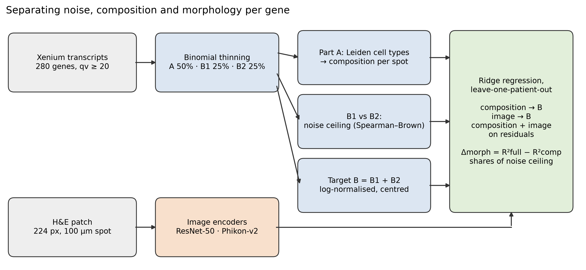
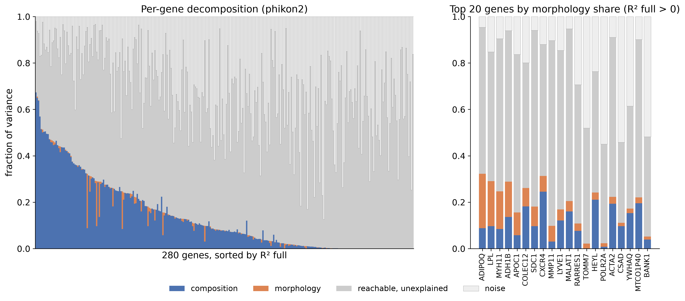
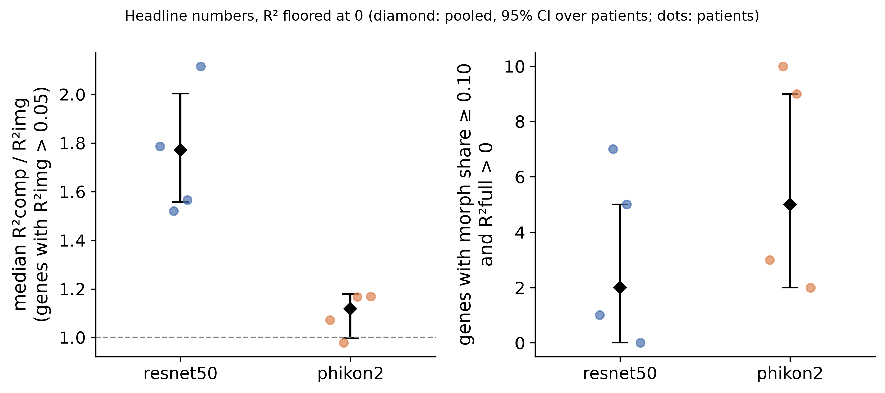
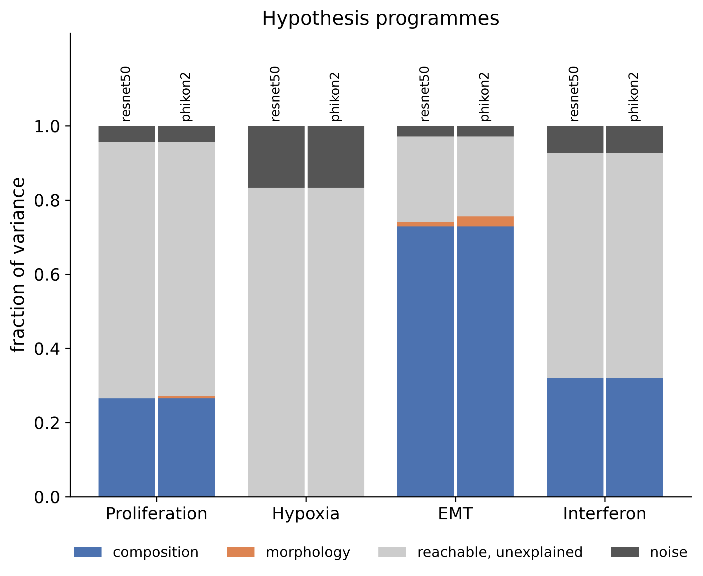
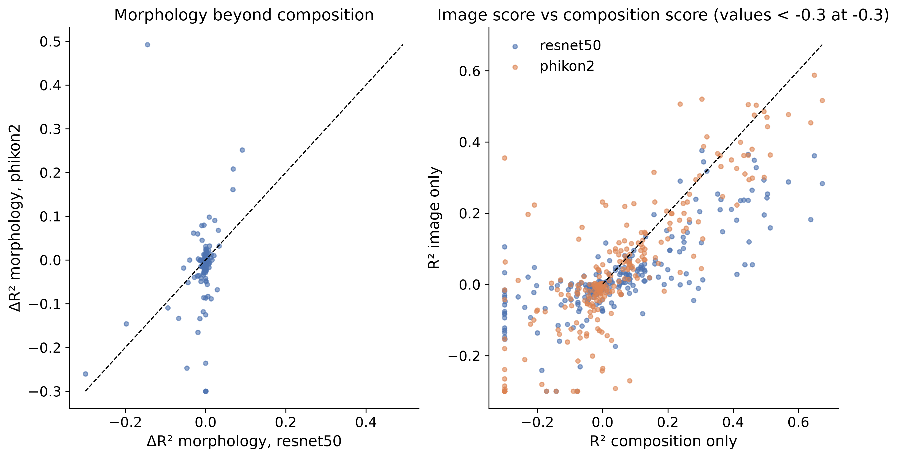

# What Does Tissue Morphology Encode? Separating Measurement Noise, Cell-Type Composition and Morphology in H&E-to-Gene-Expression Prediction

**Bipra Bhanu Mohanty, Madhur**
DH607 Computational Multi-omics, Indian Institute of Technology Bombay. Instructor: Prof. Saket Choudhary.
24 November 2026

---

## 1. Abstract

Deep-learning models that predict spatial gene expression from haematoxylin and eosin (H&E) images are usually summarised by a single per-gene accuracy score. That score mixes three sources: measurement noise in the expression target, the cell-type composition of the tissue, and morphological signal beyond composition. We separated these sources per gene on a 10x Genomics Xenium breast cancer dataset from HEST-1k (280 genes, 4 patients, 100 µm spots).

- **Noise ceiling.** Binomial thinning of transcripts gave an independent split-half estimate for each gene.
- **Composition.** Cell types were called on a held-apart half of the transcripts.
- **Decomposition.** Ridge models on composition, image features (ResNet-50, Phikon-v2), and image features on the composition residuals, all evaluated leave-one-patient-out.

Noise was not the bottleneck: the median noise ceiling was 0.707, and only 3 of 280 genes (1.1%) were noise-limited. Apparent image success was mostly composition. Among genes predicted by the image model, the median ratio of composition R² to image R² was 1.77 (95% CI 1.56–2.00) for ResNet-50 and 1.12 (1.00–1.18) for Phikon-v2. Image signal beyond composition appeared in only 2 and 5 genes, all adipose/lipid or smooth-muscle markers, and only one gene (MYH11) replicated in at least 3 of 4 patients. At this resolution and on this panel, H&E-based expression prediction largely reads out cell-type composition.

## 2. Introduction

Predicting spatially resolved gene expression from routine H&E histology would make molecular read-outs available for the very large archives of stained slides. Many methods have been proposed. Benchmarks report modest and dataset-dependent accuracy, and method rankings vary with dataset and evaluation protocol [1, 2]. HEST-1k [1] standardised the data and a benchmark of foundation-model encoders. Wang et al. [2] compared eleven methods and found limited generalisability across datasets.

A single correlation or R² per gene is hard to interpret. A low score may mean that the gene's measured expression is too noisy to predict at all. A high score may mean only that the image identifies cell types, since many genes are cell-type markers. Neither case shows that morphology carries information about expression beyond which cells are present. Without separating these sources, it is unclear whether better image encoders see more biology or just recognise cell types better.

We propose a per-gene, three-way decomposition of predictability into noise, composition and morphology, expressed as fractions of a gene-specific noise ceiling. Our contributions are:

- **A decomposition protocol.** Data thinning [6] provides an independent noise ceiling and an independent cell-type composition from the same tissue, without a second assay.
- **Its application** to a Xenium breast cancer dataset with two encoders (ResNet-50 [4] and Phikon-v2 [3]) under leave-one-patient-out validation, with pre-registered robustness analyses.
- **Evidence** that apparent image-to-expression success at 100 µm is mostly composition, and that reproducible morphology signal beyond composition is essentially absent on this panel.

## 3. Data

We used HEST-1k v1.3.0 [1], which pairs H&E images with spatial transcriptomics. We selected the 10x Genomics Xenium study *"Human Breast FFPE with Biomarkers & Housekeeping Genes Custom Panel"* [5]. It comprises 11 sections from 4 patients with a 280-gene panel, at a pixel size of about 0.274 µm. Xenium provides single-transcript coordinates, which made thinning and cell typing possible on the same tissue as the prediction target.

We used one representative section per patient: TENX191 (P1), TENX195 (P2), TENX199 (P3) and TENX202 (P4). One section per patient keeps leave-one-patient-out validation intact. The choice was also forced by repeated network failures when downloading the remaining sections.

Spots were the HEST pseudo-spots for Xenium: 100 µm squares on a 100 µm grid. Each spot was paired with a 224 × 224 px H&E patch at 0.5 µm/px centred on the spot. Spots with fewer than 3 cells or fewer than 50 target counts were removed. All 280 genes were detected in at least 10% of spots and were retained.

**Table 1.** Samples used. *Spots* are spots with an H&E patch, then those kept after filtering. *Cells* are cells with at least 10 part-A transcripts that received a type. *"Other"* is the share of typed cells with no clear marker signal.

| Sample | Patient | Spots (patch / kept) | Typed cells | "Other" (%) | Transcripts inside spots (%) |
|---|---|---|---|---|---|
| TENX191 | P1 | 4,949 / 4,605 | 193,448 | 22.1 | 99.8 |
| TENX195 | P2 | 6,254 / 5,971 | 319,213 | 9.4 | 99.9 |
| TENX199 | P3 | 2,259 / 2,247 | 146,234 | 0.0 | 99.5 |
| TENX202 | P4 | 4,291 / 4,253 | 197,820 | 9.6 | 99.8 |

## 4. Methods

**Figure 0. One set of transcripts provides the composition, the noise ceiling and the target.** Transcripts are thinned into three independent parts. Part A defines cell types and per-spot composition. B1 and B2 give the noise ceiling, and their sum B is the prediction target. Image features enter the ridge models alongside composition, and all models are evaluated leave-one-patient-out.

### 4.1 Quality control and binomial data thinning

We kept transcripts with Phred-scaled quality qv ≥ 20 that mapped to panel genes. Control probes (negative-control, blank, unassigned, deprecated, intergenic and antisense codewords) were removed. Each remaining transcript was assigned independently to part A, B1 or B2 with probabilities 0.5, 0.25 and 0.25 (random seed 0). For the count X_gs of gene g in spot s, this gives

  (A_gs, B1_gs, B2_gs) | X_gs ~ Multinomial(X_gs; 0.5, 0.25, 0.25).

If X_gs ~ Poisson(λ_gs), the three parts are independent Poisson variables with means λ/2, λ/4 and λ/4 [6]. Part A was used only for cell typing. B = B1 + B2 was the prediction target, and B1 and B2 were used only for the noise ceiling.

### 4.2 Spot construction and cell typing

Transcripts were assigned to the 100 µm square around each spot centre in H&E pixel coordinates. For cell typing, part-A counts were aggregated per cell, keeping cells with at least 10 part-A transcripts. Each sample was processed separately in Scanpy [10]:
1. library-size normalisation (to 100 counts), log1p, scaling (clipped at 10) and 30-component principal component analysis (PCA);
2. an exact 15-nearest-neighbour graph;
3. Leiden clustering [9] at resolution 1.0.

Each cluster was annotated with the highest-scoring of 10 marker-defined types: epithelial/tumour, fibroblast, myeloid, endothelial, T cell, B/plasma, mast, adipocyte, myoepithelial and perivascular smooth muscle. A cluster whose best score was below 0.3 was labelled "Other". Composition per spot was the vector of type fractions (11 values including "Other") plus log1p of the cell count, giving 12 features.

### 4.3 Image encoders

Each patch was embedded with two encoders. ResNet-50 [4] used ImageNet [12] weights (IMAGENET1K_V2), with global average pooling giving a 2,048-dimensional vector. Phikon-v2 [3] is a ViT-L pathology foundation model trained with DINOv2 on public slides; its CLS token gives a 1,024-dimensional vector. Gated foundation models (UNI2-h, Virchow2, H-optimus, CONCH) could not be accessed.

### 4.4 Noise ceiling

For each sample and gene, the target transform was y = log1p(100 · C_gs / Σ_g C_gs), applied separately to C = B, B1 and B2. Let r be the Pearson correlation between the transformed B1 and B2 across spots. The noise ceiling is the Spearman–Brown [7, 8] reliability of the two-half sum:

  ceiling = 2r / (1 + r), clipped to [0, 1].

We use the ceiling as the maximum achievable R² for predicting B. Programme scores were defined in three steps:
1. z-score each member gene within sample;
2. average over the programme's member genes (at least 3 needed);
3. compute the score separately for B, B1 and B2, so that each programme also has a noise ceiling.

The programmes were proliferation (20 genes), EMT (15), hypoxia (8) and interferon (4).

### 4.5 Ridge decomposition

Targets were centred within each sample. Features were z-scored within each sample to remove stain and batch offsets; columns constant within a sample were set to 0. We fitted three ridge models, each with no intercept and computed by singular value decomposition (SVD):

- **Composition model:** composition features → B.
- **Image model:** image features → B.
- **Full model:** the composition model, plus an image ridge fitted to the training residuals of the composition model. The full prediction is the sum of the two.

From these we computed Δmorph = R²_full − R²_comp, the gain from image features beyond composition, and the partial R² (SSE_comp − SSE_full)/SSE_comp, where SSE is the sum of squared errors on the held-out sample.

Shares were expressed as fractions of the noise ceiling:
- comp_share = R²_comp / ceiling;
- morph_share = Δmorph / ceiling;
- both only for genes with ceiling ≥ 0.2.

Held-out R² can be strongly negative for a gene with almost no variance in one held-out sample. For example, NPY1R reached Δmorph = 2.24 in patient P4 with Phikon-v2. For the headline share-based quantities (per-gene categories use unfloored values) we therefore floored each held-out sample's R² at 0 before averaging (R²₊ = max(R², 0)). This was specified before the final shares were computed.

Genes were categorised as:
- *noise-limited* if ceiling < 0.2;
- otherwise *morphology-visible* if morph_share ≥ 0.10;
- otherwise *composition-explained* if R²_img ≥ 0.10 · ceiling;
- otherwise *not predicted*.

### 4.6 Validation

All models used leave-one-patient-out (LOPO) validation, with 4 outer folds. Within each training set, the ridge penalty α was chosen per target by inner LOPO over the 3 training patients. α was picked from 21 log-spaced values between 10⁻¹ and 10⁹, minimising pooled inner squared error. The grid's upper end was extended from 10⁶ after 89% of residual-model fits chose the boundary value (Appendix B). Metrics were computed per held-out sample and averaged over the 4 samples.

As a negative control, image rows were permuted within each training sample, and the image model was refitted and evaluated on unpermuted test features (ResNet-50 only). Uncertainty was estimated by a patient-level bootstrap: 1,000 resamples of the 4 held-out patients with replacement, recomputing each pooled statistic. We report 95% percentile intervals.

### 4.7 Robustness analyses

The following analyses and their decision thresholds were fixed before their results were seen.

1. **Image → composition.** The same ridge and LOPO procedure predicted each cell-type fraction from image features. R² ≥ 0.3 was read as "the image encodes this cell type".
2. **Per-patient replication.** Headline statistics were recomputed per held-out patient, together with the number of patients in which each gene passed the morphology criterion.
3. **Joint cell typing.**
   - The same part-A counts from the 4 samples were pooled. Up to 100,000 cells per sample were used for PCA and clustering, and Harmony was applied to all cells.
   - Harmony [11] integrated them by sample, followed by Leiden clustering and the same marker rule.
   - Labels were transferred to all cells by 15-nearest-neighbour transfer, and the decomposition was rerun.
4. **Benchmark comparison.** The median naive Pearson r of the image model was compared with published HEST-Benchmark values [1].

## 5. Results

### 5.1 Noise is not the bottleneck at 100 µm

Almost every gene was measured reliably enough to be predictable, yet most genes were not predicted. The median noise ceiling was 0.707. It rose with expression: medians across gene mean-count quartiles were 0.588, 0.702, 0.706 and 0.819. Per-patient medians ranged from 0.618 to 0.818, and the pooled median's bootstrap 95% CI was 0.643–0.779. Only 3 of 280 genes (1.1%) had a ceiling below 0.2, and 48 genes (17%) had a ceiling below 0.5. Even so, 226 of 280 genes (ResNet-50) and 181 of 280 (Phikon-v2) were classified as not predicted across patients. The shuffled-image control gave a median |R²| of 0.0007, confirming that the image models did not fit spurious structure.

**Figure 1. Most genes have high noise ceilings but low image R².** Each point is one of 280 genes (blue) or 4 programmes (red), plotting the noise ceiling against the leave-one-patient-out R² of the ResNet-50 image model. The dashed line marks R² = ceiling. R² values below −0.3 are drawn at −0.3.

### 5.2 Prediction success is mostly composition

When the image model succeeded, composition alone explained as much or more. Among genes with R²_img > 0.05, we computed the median ratio R²_comp / R²_img with R² floored at 0:
- ResNet-50: 1.77 (95% CI 1.56–2.00, n = 105 genes);
- Phikon-v2: 1.12 (1.00–1.18, n = 142).

Per held-out patient, the ratio ranged from 1.52 to 2.12 for ResNet-50 and from 0.98 to 1.17 for Phikon-v2. The median Δmorph across genes was close to zero for both encoders: 9.2 × 10⁻⁶ (ResNet-50) and 4.0 × 10⁻⁵ (Phikon-v2).

In the unfloored per-gene categories, 51 (ResNet-50) and 90 (Phikon-v2) genes were composition-explained. Phikon-v2 lifted more genes above R²_img = 0.05 than ResNet-50 (100 vs 59 genes, unfloored), but did so mainly by reproducing composition. Its ratio stayed near 1, and Δmorph agreed only weakly between encoders (Pearson r = 0.19 across genes; Appendix Figure A1).

**Figure 2. For most genes, the reachable variance is either explained by composition or not explained at all.** Each bar is one gene's variance split into composition (R²_comp), morphology (Δmorph), reachable but unexplained (ceiling − R²_full) and noise (1 − ceiling). Values come from Phikon-v2 with held-out R² floored at 0. The left panel shows all 280 genes sorted by R²_full. The right panel shows the 20 genes with the largest morphology share among those with R²_full > 0.

**Figure 3. The composition-dominance result holds in every patient.** Diamonds are pooled estimates and bars are 95% patient-bootstrap intervals (1,000 resamples). Dots are the four held-out patients. Left: median R²_comp / R²_img among genes with R²_img > 0.05, with a dashed line at 1. Right: number of genes with morph_share ≥ 0.10 and R²_full > 0.

### 5.3 H&E features encode the major cell types

Image features predicted the fractions of the abundant cell types across patients, which explains why image models recover composition-driven expression. Leave-one-patient-out R² for predicting cell-type fractions from images:

| Cell type | ResNet-50 | Phikon-v2 |
|---|---|---|
| Epithelial/tumour | 0.42 | 0.53 |
| T cells | 0.37 | 0.53 |
| Fibroblasts | 0.25 | 0.40 |
| Endothelial cells | 0.07 | 0.38 |
| Myeloid cells | 0.14 | 0.26 |

Under the pre-set threshold (R² ≥ 0.3), both encoders encoded epithelial and T cells, and Phikon-v2 also encoded fibroblasts and endothelial cells. Adipocyte fractions were not predictable (R² −0.81 and −1.16). Mast, B/plasma, perivascular and myoepithelial fractions were nearly constant in some held-out samples, so their R² was undefined or unstable and was not interpreted.

**Figure 4. H&E image features encode the major cell types.** Bars show the mean leave-one-patient-out R² for predicting each cell-type fraction from image features, for both encoders. Dots are the four held-out patients. The dashed line marks the pre-set threshold R² = 0.3, and values below −0.3 are drawn at −0.3. Rare types with near-constant fractions are omitted.

### 5.4 No reproducible morphology signal beyond composition

Only a handful of genes gained from image features beyond composition, and none were tumour cell-state genes. With R² floored at 0, the genes with morph_share ≥ 0.10 and R²_full > 0 were:
- ResNet-50: 2 genes (95% CI 0–5), ADIPOQ and LPL;
- Phikon-v2: 5 genes (2–9), ADIPOQ, LPL, MYH11, ADH1B and APOC1.

All are adipose/lipid-metabolism (ADIPOQ, LPL, ADH1B, APOC1) or smooth-muscle (MYH11) markers. These cell types were captured poorly by our composition features, and adipocyte fraction was not predictable from images either (Section 5.3). The most plausible reading is therefore composition missed by cell segmentation and typing, not morphology. Only MYH11 (Phikon-v2) passed the criterion in at least 3 of 4 held-out patients (`results/robustness/floored/replicated_morph_genes.csv`), and no ResNet-50 gene did. Among the genes previously highlighted, per-patient Δmorph changed sign between patients for ADIPOQ and NPY1R (both encoders) and for COLEC12 (ResNet-50). COLEC12 (Phikon-v2) stayed positive but passed the criterion in only 2 of 4 patients.

### 5.5 Biological programmes

No programme showed morphology signal. Proliferation, EMT and interferon were explained by composition, and hypoxia was not predicted although it was measured reliably (Table 2).

**Table 2.** Programme results (core, unfloored values; R / P = ResNet-50 / Phikon-v2). The noise ceiling and R²_comp do not depend on the encoder.

| Programme | Genes | Ceiling | R²_comp | R²_img (R / P) | Δmorph (R / P) | Verdict |
|---|---|---|---|---|---|---|
| Proliferation | 20 | 0.957 | 0.265 | 0.132 / 0.231 | −0.008 / 0.006 | composition |
| EMT | 15 | 0.971 | 0.729 | 0.468 / 0.610 | 0.013 / 0.027 | composition |
| Interferon | 4 | 0.926 | 0.320 | 0.075 / 0.166 | −0.000 / −0.004 | composition |
| Hypoxia | 8 | 0.833 | −0.072 | −0.037 / −0.086 | −0.000 / −0.027 | not predicted |

Composition reached 75% of the noise ceiling for EMT (0.729 of 0.971), 35% for interferon and 28% for proliferation. Every programme morph_share was below 0.03. For interferon, the ResNet-50 image model alone fell just below the categorisation threshold (R²_img 0.075 < 0.10 · ceiling), so it was categorised as not predicted. Its composition R² nevertheless shows that the predictable part is composition.

**Figure 5. Programme predictability is composition, not morphology.** Stacked bars split each programme's variance into composition, morphology, reachable-but-unexplained and noise, for ResNet-50 and Phikon-v2 side by side. Composition and morphology are capped at the noise ceiling, so each bar sums to 1.

### 5.6 Robustness

**Joint cell typing.** Pre-set rule: joint labels count as an improvement only if they raise R²_comp without changing Δmorph beyond its CI. They did not strengthen composition. The number of genes with R²_comp > 0.05 fell from 104 to 91, and the median R²_comp went from −0.0025 to −0.0030.

Joint typing did relabel the most doubtful clusters:
- TENX202 "mast" cells became mainly "Other" (51%) and epithelial (37%);
- TENX191 "Other" cells became myoepithelial (56%) and epithelial (44%).

However, the cluster receiving most TENX191 cells was 95% TENX191, which indicates a residual batch effect. Morphology was unchanged: genes passing the morphology criterion went 0 → 0 (ResNet-50) and 2 → 1 (Phikon-v2), within the patient-bootstrap intervals of the unfloored analysis (0–4 and 1–9). The morphology conclusion is therefore unchanged under an alternative joint labelling. Per the pre-set rule, the per-sample labels remain the main result.

**Figure 6. Joint cell typing neither strengthens composition nor changes morphology.** (A) Per-gene R²_comp with per-sample labels (x) versus joint labels (y); axes are clipped at −0.3. (B) Per-gene Δmorph before versus after, for both encoders. (C) Share of "Other" cells per sample before and after joint typing.

**Benchmark comparison.** The image models scored below published random-split benchmarks, as expected under leave-one-patient-out. The median naive Pearson r over the 50 most-expressed genes was 0.279 (ResNet-50) and 0.353 (Phikon-v2), against about 0.47 (ResNet-50) and 0.53 (Phikon v1) reported for the HEST-Benchmark IDC task [1]. The encoder ranking agrees. The comparison is approximate: gene sets, splits and summary statistics differ.

**Quality gates.** Four quality gates were checked before the results were accepted. G1 (cell typing), G2 (feature–spot barcode matching) and G4 (final review) passed. G3 (model sanity) passed with one documented exception: the full model matched or exceeded the composition model (R²_full ≥ R²_comp − 0.01) for 91.4% (ResNet-50) and 80.0% (Phikon-v2) of genes, short of the planned 95% (Appendix A).

## 6. Discussion

**Interpretation.** At 100 µm resolution on a 280-gene Xenium panel, the predictable part of expression from H&E was largely the part explained by cell-type composition. Image features recovered the abundant cell types well (epithelial and T-cell R² 0.37–0.53), and composition alone matched or exceeded the image model for the genes the image predicted. The remaining variance was mostly reachable but unexplained by either model, not noise.

**Relation to the hypothesis.** We hypothesised that (i) much apparent failure is noise, (ii) much apparent success is composition, and (iii) proliferation, hypoxia, EMT and interferon programmes are visible in morphology.
- (i) was **not confirmed**: noise ceilings were high, and only 1.1% of genes were noise-limited.
- (ii) was **confirmed**, in all 4 patients and for both encoders.
- (iii) was **not confirmed**: all four programmes had morph_share < 0.03, three were explained by composition, and hypoxia was not predicted although reliably measured.

**Why Phikon-v2 gains.** The pathology foundation model raised image-only R² mainly by encoding composition better. It predicted fibroblast and endothelial fractions above the threshold where ResNet-50 did not, and its R²_comp / R²_img ratio approached 1 rather than revealing additional morphology. The few genes it added beyond composition were adipose and smooth-muscle markers, which are better explained by cell types our composition features missed.

**Implications for evaluating image-to-omics models.** Accuracy scores for H&E-to-expression models should be reported against a composition baseline and a noise ceiling. Without them, an encoder that recognises cell types better looks like one that "sees" more expression biology. Leave-one-patient-out evaluation is also essential. Absolute performance here was lower than published random-split benchmarks, which can overstate cross-patient generalisation.

**Limitations.**
- **Scale.** One study, one section per patient (n = 4 patients), and a 280-gene targeted panel, so conclusions may not extend to whole-transcriptome data or other tissues. The interferon programme has only 4 genes.
- **Cell labels.** Labels were imperfect: the TENX202 "mast" cluster and 22% "Other" in TENX191 weaken the composition model, so Δmorph is an upper bound. Joint typing did not remove this, because a batch effect remained.
- **Thinning.** It assumes Poisson counts; overdispersed (negative-binomial) counts would make the split-half ceiling approximate.
- **Encoders.** Gated foundation models were not tested, and absolute image performance was below random-split benchmarks.
- **Model sanity check.** The full-model check reached 91.4% and 80.0% rather than the planned 95%.

## 7. Conclusion

We separated H&E-to-expression predictability into noise, composition and morphology per gene, using data thinning and leave-one-patient-out ridge models on Xenium breast cancer data. Measurement noise was not the limiting factor: most genes were reliably measured but not predicted. Where image models succeeded, cell-type composition explained as much or more, consistently across patients and for both a general and a pathology encoder. Reproducible morphology signal beyond composition was essentially absent, limited to adipose and smooth-muscle markers that reflect incomplete cell typing. Image-to-omics models should therefore be evaluated against composition baselines and noise ceilings.

## 8. Future work

- Test gated pathology foundation models (UNI2-h, Virchow2, H-optimus, CONCH).
- Use all 11 sections and additional studies, including whole-transcriptome Visium HD.
- Validate on TCGA bulk expression.
- Use segmentation-aware typing of adipocytes and stromal cells, and better batch-corrected joint typing.
- Use negative-binomial data thinning to handle overdispersion.

## 9. Data and code availability

- **Code, result tables and figures:** https://github.com/biprabhanu/histology-transcriptomics-decomposition
- **Data:** HEST-1k v1.3.0, https://github.com/mahmoodlab/HEST (Hugging Face dataset `MahmoodLab/hest`, gated).
- **Running the scripts:** set `DH607_STORAGE` to a storage root; data, features and results are written under `$DH607_STORAGE/dh607`. Run commands are in the repository README.

## 10. References

1. Jaume G, et al. HEST-1k: A Dataset for Spatial Transcriptomics and Histology Image Analysis. *Advances in Neural Information Processing Systems (Datasets and Benchmarks Track)*, 2024. arXiv:2406.16192.
2. Wang C, Chan AS, Fu X, Ghazanfar S, Kim J, Patrick E, Yang JYH. Benchmarking the translational potential of spatial gene expression prediction from histology. *Nature Communications* 16:1544, 2025. doi:10.1038/s41467-025-56618-y.
3. Filiot A, Jacob P, Mac Kain A, Saillard C. Phikon-v2, A large and public feature extractor for biomarker prediction. arXiv:2409.09173, 2024.
4. He K, Zhang X, Ren S, Sun J. Deep residual learning for image recognition. *Proc. IEEE CVPR*, 770–778, 2016.
5. 10x Genomics. Xenium datasets. https://www.10xgenomics.com/datasets
6. Neufeld A, Dharamshi A, Gao LL, Witten D. Data thinning for convolution-closed distributions. *Journal of Machine Learning Research* 25(57):1–35, 2024.
7. Spearman C. Correlation calculated from faulty data. *British Journal of Psychology* 3:271–295, 1910.
8. Brown W. Some experimental results in the correlation of mental abilities. *British Journal of Psychology* 3:296–322, 1910.
9. Traag VA, Waltman L, van Eck NJ. From Louvain to Leiden: guaranteeing well-connected communities. *Scientific Reports* 9:5233, 2019.
10. Wolf FA, Angerer P, Theis FJ. SCANPY: large-scale single-cell gene expression data analysis. *Genome Biology* 19:15, 2018.
11. Korsunsky I, et al. Fast, sensitive and accurate integration of single-cell data with Harmony. *Nature Methods* 16:1289–1296, 2019.
12. Deng J, Dong W, Socher R, Li L-J, Li K, Fei-Fei L. ImageNet: A large-scale hierarchical image database. *Proc. IEEE CVPR*, 248–255, 2009.

---

## Appendix A. Quality gates

| Gate | Criterion | Result |
|---|---|---|
| G1: cell typing | ≥ 85% of transcripts in spots; "Other" ≤ 25%; epithelial is the largest named type | Pass. 99.5–99.9% in spots; "Other" 22.1 / 9.4 / 0.0 / 9.6%; epithelial is the largest named type in every sample. The "Other" threshold was lowered from 0.5 to 0.3, the one permitted adjustment. |
| G2: features | Feature barcodes match spot barcodes (> 99%) | Pass. 100.0% for all 4 samples and both encoders. |
| G3 (a): noise ceiling | Rises with mean count | Pass. Quartile medians 0.588 / 0.702 / 0.706 / 0.819. |
| G3 (b): shuffled control | Median \|R²\| < 0.01 | Pass. 0.0007 (ResNet-50). |
| G3 (c): full vs composition | R²_full ≥ R²_comp − 0.01 for > 95% of genes | Below target: 91.4% (ResNet-50), 80.0% (Phikon-v2). Accepted with a caveat: the cause is image signal that does not transfer across patients, not a code error. |
| G3 (d): folds | 4 patients, each held-out sample scored once | Pass. |
| G4: final | Results complete; independent review agrees | Pass. All headline numbers were independently recomputed. |

**Figure A1. The two encoders disagree on morphology but agree that composition dominates.** Left: per-gene Δmorph for ResNet-50 versus Phikon-v2 (Pearson r = 0.19). Right: R²_comp versus R²_img for each encoder, with the diagonal. Values below −0.3 are drawn at −0.3.

## Appendix B. Decisions log and changelog

**Decisions**

| Decision | Reason |
|---|---|
| Xenium breast study from HEST-1k | Single-transcript data allow thinning and cell typing on the same tissue as the target |
| ResNet-50 and Phikon-v2; gated models skipped | No access to gated models; Phikon-v2 has open weights |
| One section per patient | Repeated network failures downloading from Hugging Face; preserves leave-one-patient-out |
| Library pins (scipy 1.13.1, numba 0.61.2) and exact kNN | Compatibility of scanpy 1.11.5 with newer scipy and umap-learn 0.6; same algorithm |
| ResNet-50 weights from the Hugging Face timm mirror | pytorch.org was unreachable; identical IMAGENET1K_V2 weights |
| "Other" threshold 0.5 → 0.3 | The only G1 adjustment allowed; TENX191 "Other" fell from 32% to 22% |
| α grid extended to 10⁹ (superset of 10⁻¹–10⁶) | 10⁶ was the boundary for 89% of residual fits |
| Shares only where ceiling ≥ 0.2 | Avoids dividing by near-zero ceilings |
| G3(c) accepted at 91.4% / 80.0% | Caused by non-transferable image signal, not a code error; chosen over a nested residual fit or stopping |
| Robustness thresholds pre-registered | Avoids tuning after seeing results |
| Held-out R² floored at 0 for shares | Single-patient outliers (NPY1R Δmorph 2.24 in P4) dominated the shares |
| Joint typing kept as a robustness check only | Did not strengthen composition; batch effect remained; not iterated further |
| One GPU only | Server IT policy; the remaining compute was CPU ridge |

**Changelog** (all on 24 November 2026 unless noted)
- 23 Nov: environment fixes; "Other" threshold changed; scope cut to one section per patient.
- Missing files obtained by a server-side retry loop and verified by SHA-256; steps 02 and 03 run for TENX195 and TENX202.
- Final 4-patient run; α grid extended; G3 accepted with a caveat; figures corrected after independent review.
- Robustness round: image → composition, benchmark comparison, per-patient bootstrap, joint cell typing; `04_decompose.py` gained an opt-in `--save-predictions` flag (default output unchanged).
- Shares recomputed with held-out R² floored at 0; fig2 and the headline-CI panel regenerated; replicated-gene table added.
- Report rewritten in research-paper format; no new analysis.
