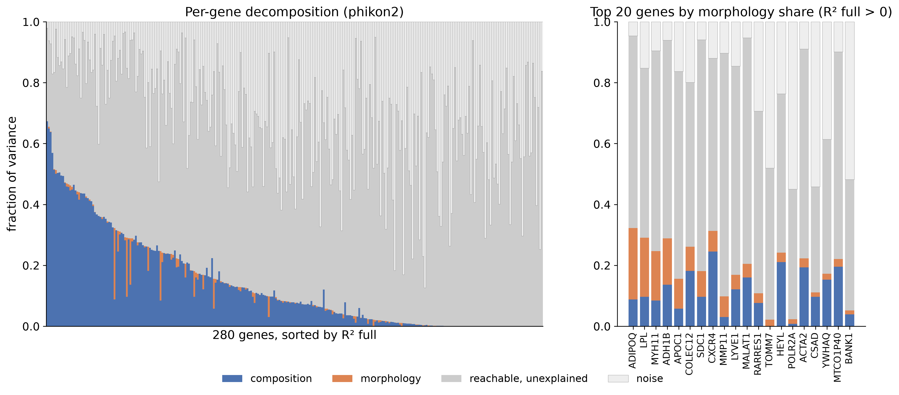
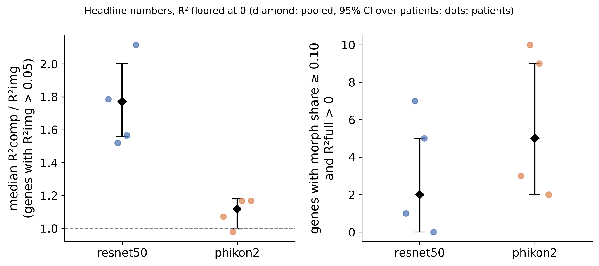
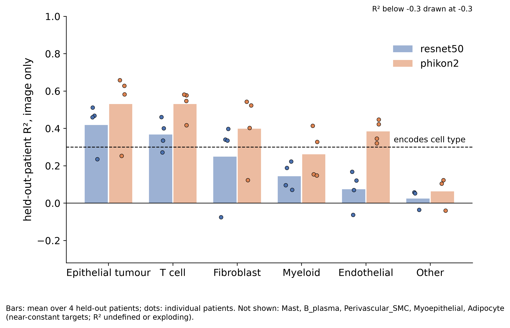

# What Does Tissue Morphology Encode? Results Summary

**Bipra Bhanu Mohanty, Madhur Omprakash Likhmani**. DH607 Computational Multi-omics, IIT Bombay. Instructor: Prof. Saket Choudhary. 24 November 2026.
*Short poster version of [PROJECT_REPORT.md](PROJECT_REPORT.md) ([PDF](PROJECT_REPORT.pdf)). All numbers come from `results/core` and `results/robustness`.*

## Key message
On a 280-gene Xenium breast cancer panel at 100 µm, H&E-to-expression models mainly read out **cell-type composition**. Measurement noise is not the bottleneck, and reproducible morphology signal beyond composition is essentially absent.

## Study in one paragraph
- **Data:** HEST-1k Xenium breast FFPE, 4 patients with one section each, 280 genes, 100 µm spots with 224 px H&E patches.
- **Thinning:** transcripts were split by binomial thinning into part A (50%), used for cell typing and composition, and B1 and B2 (25% each).
- **Noise ceiling:** the Spearman–Brown reliability of B1 versus B2.
- **Models:** ridge models predicted B = B1 + B2 from composition, from image features (ResNet-50, Phikon-v2), and from image features fitted on the composition residuals.
- **Evaluation:** leave-one-patient-out, with 95% CIs from a patient-level bootstrap.
- **Shares:** expressed as fractions of the noise ceiling, with held-out R² floored at 0.

## Findings

**1. Noise is not the bottleneck.** The median noise ceiling is 0.707 (95% CI 0.643–0.779), and only 3 of 280 genes (1.1%) are noise-limited. Even so, 226 (ResNet-50) and 181 (Phikon-v2) of 280 genes are not predicted across patients. → [`fig1_noise_resnet50.png`](../results/core/figures/fig1_noise_resnet50.png)

**2. Prediction success is mostly composition.** Among genes the image predicts (R²_img > 0.05), the median R²_comp / R²_img is 1.77 (95% CI 1.56–2.00, n = 105) for ResNet-50 and 1.12 (1.00–1.18, n = 142) for Phikon-v2. The result holds in 4 of 4 held-out patients (per-patient ratio 1.52–2.12 and 0.98–1.17).

**3. H&E features encode the major cell types.** Leave-one-patient-out R² for predicting cell-type fractions from images, against the pre-set threshold of 0.3:

| Cell type | ResNet-50 | Phikon-v2 |
|---|---|---|
| Epithelial | 0.42 | 0.53 |
| T cells | 0.37 | 0.53 |
| Fibroblasts | 0.25 | 0.40 |
| Endothelial | 0.07 | 0.38 |

**4. No reproducible morphology beyond composition.** Only 2 genes (ResNet-50: ADIPOQ, LPL) and 5 genes (Phikon-v2: ADIPOQ, LPL, MYH11, ADH1B, APOC1) gain from the image beyond composition (morph_share ≥ 0.10, R²_full > 0). All are adipose/lipid or smooth-muscle markers, cell types our composition features capture poorly. Only MYH11 replicates in at least 3 of 4 patients ([`replicated_morph_genes.csv`](../results/robustness/floored/replicated_morph_genes.csv)).

## Programme verdicts

The ceiling and R²_comp do not depend on the encoder; R²_img and Δmorph are given as ResNet-50 / Phikon-v2. Values are core (unfloored).

| Programme | Genes | Ceiling | R²_comp | R²_img | Δmorph | Verdict |
|---|---|---|---|---|---|---|
| Proliferation | 20 | 0.957 | 0.265 | 0.132 / 0.231 | −0.008 / 0.006 | composition |
| EMT | 15 | 0.971 | 0.729 | 0.468 / 0.610 | 0.013 / 0.027 | composition |
| Interferon | 4 | 0.926 | 0.320 | 0.075 / 0.166 | −0.000 / −0.004 | composition |
| Hypoxia | 8 | 0.833 | −0.072 | −0.037 / −0.086 | −0.000 / −0.027 | not predicted (not noise) |

No programme is morphology-visible: every morph_share is below 0.03. → [`fig3_programmes.png`](../results/core/figures/fig3_programmes.png)

## Robustness
- **Encoders:** Phikon-v2 lifts more genes above R²_img = 0.05 than ResNet-50 (100 vs 59, unfloored), mostly by encoding composition. Δmorph agrees only weakly between the encoders (r = 0.19).
- **Joint cell typing** (Harmony) did not strengthen composition: 91 vs 104 genes with R²_comp > 0.05, with a residual batch effect. The morphology conclusion is unchanged under this alternative labelling. → [`fig6_joint_vs_persample.png`](../results/robustness/figures/fig6_joint_vs_persample.png)
- **Benchmark:** the image models score below published random-split benchmarks (top-50 r 0.28 / 0.35 vs about 0.47 / 0.53), as expected under leave-one-patient-out. The encoder ranking agrees.

## Hypothesis check
| Hypothesis | Result |
|---|---|
| Much apparent failure is noise | Not confirmed (1.1% of genes noise-limited) |
| Much apparent success is composition | Confirmed (4/4 patients, both encoders) |
| Programmes are visible in morphology | Not confirmed (all morph_share < 0.03) |

## Limitations
- **Scale:** one study, one section per patient (n = 4), 280-gene panel; the interferon programme has only 4 genes.
- **Cell labels:** imperfect labels (TENX202 "mast" cluster, 22% "Other" in TENX191) make Δmorph an upper bound.
- **Modelling:**
  - thinning assumes Poisson counts;
  - gated foundation models were not tested;
  - the full model matched or exceeded composition (within 0.01) for 91.4% / 80.0% of genes, short of the planned 95%.

## Suggested poster figures
| Figure | Title |
|---|---|
| [`fig0_pipeline.png`](../results/figures/fig0_pipeline.png) | Separating noise, composition and morphology per gene |
| [`fig1_noise_resnet50.png`](../results/core/figures/fig1_noise_resnet50.png) | Failure is not noise: high ceilings, low image R² |
| [`fig2_decomposition_phikon2_floored.png`](../results/robustness/figures/fig2_decomposition_phikon2_floored.png) | Where each gene's predictability comes from |
| [`fig_headline_ci_floored.png`](../results/robustness/figures/fig_headline_ci_floored.png) | The composition result holds in every patient |
| [`fig5_image_to_composition.png`](../results/robustness/figures/fig5_image_to_composition.png) | H&E image features encode the major cell types |
| [`fig3_programmes.png`](../results/core/figures/fig3_programmes.png) | Biological programmes: composition, not morphology |
| [`fig6_joint_vs_persample.png`](../results/robustness/figures/fig6_joint_vs_persample.png) | Joint cell typing: composition not stronger, morphology unchanged |

*Key references: HEST-1k (Jaume et al., NeurIPS 2024); Wang et al., Nat. Commun. 2025; Phikon-v2 (Filiot et al., 2024); data thinning (Neufeld et al., JMLR 2024). The full list is in the report.*
